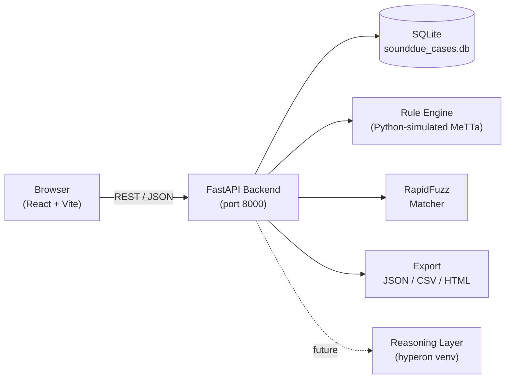

# SoundDue

A prototype tool for detecting ownership discrepancies in music rights records. It ingests CSV/XLSX uploads from multiple sources, normalises column names, applies symbolic reconciliation rules, and surfaces findings with full evidence trails for human review.

## Who it's for

- **Rights administrators** checking whether ownership records are consistent across sources
- **CMOs and publishers** preparing for audit or distribution
- **Developers and researchers** evaluating rule-based approaches to rights data quality

## Architecture



> **Note**: The reasoning layer (hyperon/MeTTa) is installed in a separate venv but not yet integrated. Rules are currently simulated in Python. See [Prototype status](#prototype-status).

## Quick start

**Prerequisites**: Python 3.13, Node 18+

```bash
# 1. Clone
git clone <repo> sounddue && cd sounddue

# 2. Backend
cd backend
pip install -r requirements.txt
cd ..

# 3. Frontend
cd frontend
npm install
cd ..

# 4. Start both servers (two terminals)
make backend        # → http://localhost:8000
make frontend       # → http://localhost:5173

# 5. Seed the Midnight Train demo case
make demo
```

Then open **http://localhost:5173** and follow the printed steps.

## Running tests

```bash
# Backend (289 tests)
make test

# Frontend Playwright smoke test (partially working — see prototype status)
cd frontend && npx playwright test
```

## Export

Once a case has been analysed, export findings in three formats:

| Format | URL |
|--------|-----|
| JSON (full evidence + rule traces) | `GET /cases/{id}/export?format=json` |
| CSV (one row per finding) | `GET /cases/{id}/export?format=csv` |
| HTML (readable report) | `GET /cases/{id}/export?format=html` |

Each finding includes a **plain-language explanation** generated from the structured rule trace — no values are invented. Set `SOUNDDUE_LLM_REWRITE=1` (with an OpenAI key) to optionally improve the wording; any rewrite that introduces new identifiers or numbers is silently discarded.

## Prototype status

### What works

- File upload (CSV/XLSX), column mapping with synonym dictionary + RapidFuzz suggestions, auto-confirmation of exact matches
- File validation (missing columns, type errors)
- Four symbolic rules: `possible_missing_claim`, `incomplete_ownership_info`, `conflicting_shares`, `unmapped_recording`
- Fuzzy recording ↔ work matching with corroboration requirement and version-mismatch penalty
- Review workflow: accept / reject / correct (append-only, never overwrites)
- Rerun with fingerprint-based diff (new / changed / resolved / unchanged / rejected)
- Export in JSON, CSV, HTML with plain-language explanations
- Full audit log of every action

### Shortcuts and limitations

| Item | Detail |
|------|--------|
| **Database** | SQLite, not Postgres — not suitable for concurrent production use |
| **MeTTa/hyperon** | Rules are simulated in Python; the hyperon package is installed in `reasoning/.venv` but the integration is not complete |
| **Authentication** | None — single demo user (`demo-user`) hardcoded |
| **Multi-tenancy** | Not implemented |
| **LLM explanations** | Disabled by default; requires `SOUNDDUE_LLM_REWRITE=1` and an OpenAI key |
| **SingularityNET** | A `.proto` and stub gRPC server are provided; daemon/testnet publishing is a documented step, not implemented |
| **Omega AGI** | Written plan only — see `docs/omega-plan.md` |
| **Playwright test** | Steps 1–5 pass; finding-detail navigation has a known issue and is left for follow-up |

### What is not implemented

- Real MeTTa/hyperon rule evaluation
- Production database (Postgres, migrations)
- Authentication and authorisation
- SingularityNET daemon registration and testnet publishing
- Omega AGI integration
